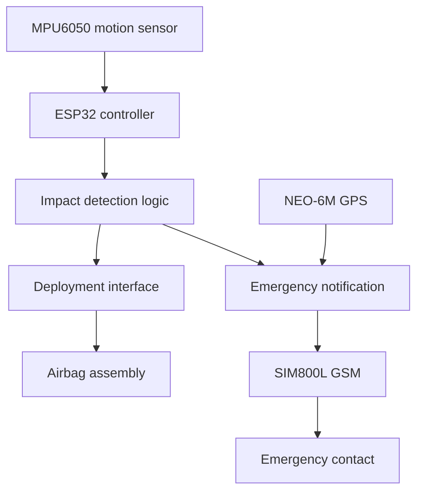

# Smart Airbag Jacket

An ESP32-based wearable safety research prototype that monitors motion,
detects potential impact events and supports emergency notification
through GSM and GPS modules.

## Project Status

Academic prototype.

This repository documents the project architecture, hardware,
firmware and available test evidence. It is not certified protective
equipment and must not be relied on for personal safety.

## Overview

The Smart Airbag Jacket combines motion sensing, embedded processing
and emergency communication in a wearable system.

An MPU6050 measures acceleration and angular velocity. An ESP32
processes the sensor data using a threshold-based detection algorithm.
When a potential impact event is detected, the controller can issue
a deployment request and initiate an emergency SMS containing the
available GPS coordinates.

The physical prototype includes a CO2-based airbag deployment mechanism.
Its mechanical design and measured performance must be documented
separately from the electronic detection system.

## Objectives

- Monitor motion using an accelerometer and gyroscope.
- Detect potential impact events using embedded firmware.
- Interface the controller with an airbag deployment subsystem.
- Retrieve location information through GPS.
- Send an emergency SMS through a GSM module.
- Evaluate detection behavior, communication and response timing.

## Hardware

| Component | Purpose |
|-----------|---------|
| ESP32 | Main controller and sensor-data processing |
| MPU6050 | Three-axis acceleration and angular-velocity measurement |
| SIM800L | GSM communication and SMS transmission |
| NEO-6M | GPS position data |
| Deployment interface | Connects the controller to the deployment subsystem |
| CO2-based inflation assembly | Physical airbag inflation mechanism |
| Power supply | Supplies the controller, sensors and communication modules |
| Jacket and airbag assembly | Wearable mechanical structure |

Exact board variants, power specifications and deployment-interface
components: [add verified details].

## Software and Tools

- Firmware language: Embedded C/C++ [confirm]
- Development environment: [add actual IDE and framework]
- Simulation: Proteus [describe what was simulated]
- Version control: Git and GitHub
- Additional tools: [add only tools actually used]

## System Architecture

The diagram represents functional relationships.
It is not an electrical wiring diagram.

## Communication Interfaces

| Connection | Interface |
|------------|-----------|
| MPU6050 to ESP32 | I2C |
| NEO-6M to ESP32 | UART |
| SIM800L to ESP32 | UART |
| ESP32 to deployment interface | Implementation-specific control output |

GPIO assignments, baud rates and supply connections are documented
in `hardware/pin_connections.md`.

## Working Principle

1. Initialize the controller and connected modules.
2. Check sensor communication and perform calibration.
3. Read acceleration and angular-velocity measurements.
4. Process the readings using the implemented detection algorithm.
5. Identify whether the configured event conditions are satisfied.
6. Record the event and issue the appropriate control request.
7. Retrieve the available GPS position.
8. Attempt to send an emergency SMS.
9. Record communication outcomes and system faults.

Actual ordering, fault handling and timing must match the firmware.

## Detection Algorithm

The prototype uses threshold-based impact detection.

Document the following from the actual implementation:

- Sensor sampling frequency: [100 Hz]
- Accelerometer measurement range: [±8 g]
- Gyroscope measurement range: [±500 °/s]
- Calibration method: [Gyro bias from 200 samples (about 2 s) at rest, rejected if the board moves or acceleration is outside 0.8 to 1.2 g]
- Filtering method, if used: [MPU6050 low-pass filter, setting 3 (about 44 Hz accelerometer / 42 Hz gyro bandwidth)]
- Event-latching and reset behavior: [Event latches and drives GPIO25 high. Reset with r, re-arm with a. A sensor fault disables detection until reboot.]

Do not treat arbitrary example thresholds as validated crash criteria.

## Firmware

Firmware source code is stored in `firmware/`.

The firmware documentation must explain:

- Controller initialization
- Sensor configuration and calibration
- Motion-data acquisition
- Detection logic
- Deployment-interface behavior
- GPS data parsing
- GSM SMS handling
- Fault handling and event logging

## Setup and Reproduction

1. Identify the exact ESP32 board and hardware revisions.
2. Review the schematic and verified pin connections.
3. Install the development environment listed below.
4. Install the required libraries at the recorded versions.
5. Configure local settings using the supplied example configuration.
6. Build and upload the firmware using the documented board settings.
7. Run the sensor and communication checks.
8. Perform detection tests using a harmless indicator or dummy load.

## Testing

Begin electronic verification with the physical deployment mechanism
disconnected and use an indicator or dummy load.
| Parameter | Measured | Target | Status |
|---|---|---|---|
| Fall detection accuracy | 93% | ≥ 90% | ✅ Passed |
| Airbag inflation time | 0.4 s | ≤ 0.5 s | ✅ Passed |
| Heartbeat accuracy | ±3 BPM | ±5 BPM | ✅ Passed |
| Temperature accuracy | ±0.3 °C | ±0.5 °C | ✅ Passed |
| Alert delay | 2–4 s | ≤ 5 s | ✅ Passed |
| Battery backup | 8 hours | ≥ 6 hours | ✅ Passed |

All measured results met the predefined design targets.

### Test methodology
| Parameter | How it was measured |
|---|---|
| Fall detection accuracy | [X correct detections out of Y fall and non-fall trials] |
| Airbag inflation time | [timing method, e.g. video frame count or oscilloscope from trigger to full inflation] |
| Heartbeat accuracy | [reference device used for comparison] |
| Temperature accuracy | [reference thermometer used] |
| Alert delay | [detection to message received, averaged over N tests] |
| Battery backup | [battery capacity and load conditions] |

## Limitations

- Threshold-based detection can produce false triggers or miss events.
- GPS reception depends on the environment.
- GSM communication depends on network and SIM availability.
- Power interruptions can affect sensing and communication.
- Electronic detection alone does not establish protective performance.
- Controlled prototype tests do not establish real-world crash safety.

Examples to adapt only if completed:

- Integrated the motion sensor with the ESP32.
- Implemented threshold-based detection firmware.
- Integrated GPS parsing and GSM SMS communication.
- Designed or assembled the electronic prototype.
- Conducted tests and documented observations.

## Future Improvements

- Evaluate detection using labeled motion datasets.
- Improve false-trigger rejection.
- Add structured event logging.
- Improve sensor and communication fault diagnostics.
- Investigate power consumption and battery monitoring.
- Evaluate mechanical and wearable-system performance through
  appropriate professional testing.

